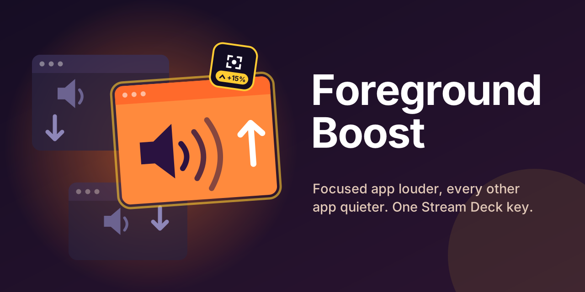
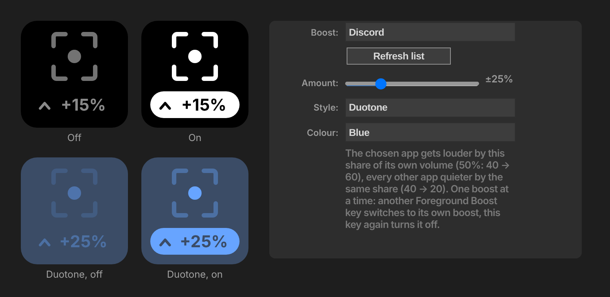

# Foreground Boost

Stream Deck toggle: focused app +15, every other app -15; press again to undo. Bundles VolumeProxy.

## Install

1. Copy this folder to `%APPDATA%\Elgato\StreamDeck\Plugins$1`.
2. `cd bin && npm install`
3. Build [VolumeProxy](https://github.com/XenSide/VolumeProxy) (`cargo build --release`) and copy `Foreground.exe` into `bin/`. The plugin starts it; only one copy runs even if several plugins bundle it.
4. Restart Stream Deck.

Requires Elgato's Volume Controller (its Audio Router on `ws://127.0.0.1:1844`).
